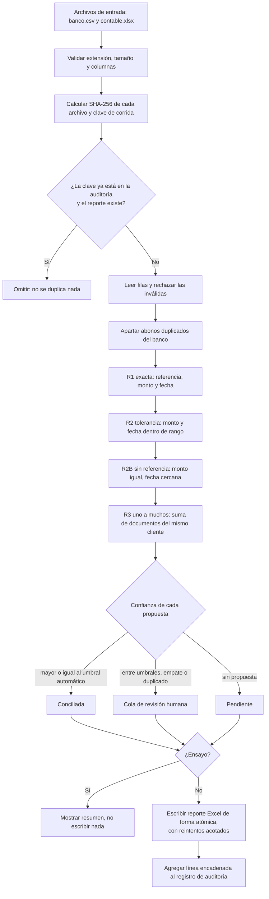

# Diagrama de flujo

Cada regla trabaja solo con las partidas que las anteriores dejaron libres. Un documento nunca se usa dos veces. Cuando dos candidatos distintos empatan, el motor no elige: manda el caso a la cola de revisión y deja libres los documentos.
